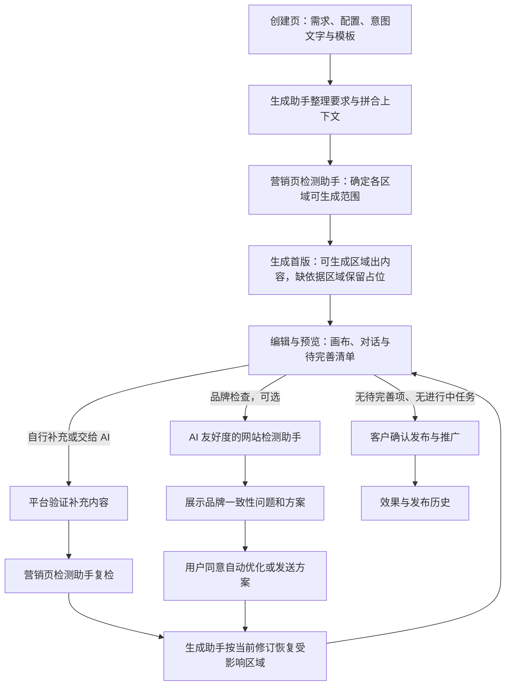
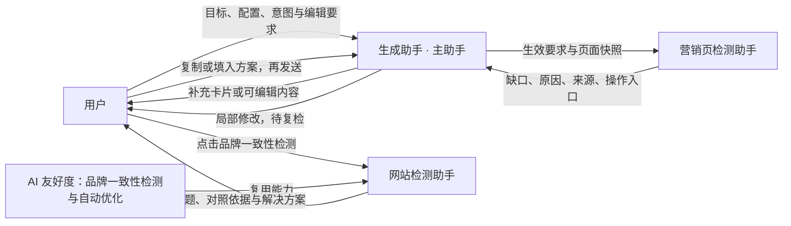
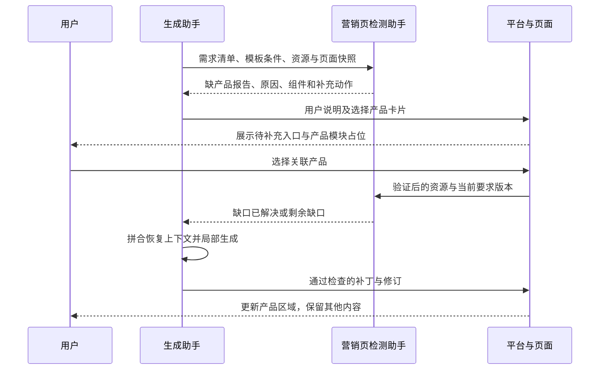
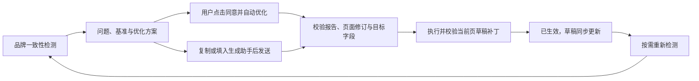

# AI 营销落地页产品设计

| 文档属性 | 内容 |
| --- | --- |
| 文档类型 | 产品需求与交互规范 |
| 文档版本 | v1.1 |
| 更新日期 | 2026-11-02 |
| 适用范围 | 智能营销落地页 |
| 读者 | 产品、设计、研发、测试、运营 |
| 配套规范 | [提示词设计](落地页提示词设计.md)、[文档索引](README.md) |

本文定义营销落地页从创建、编辑、发布到效果查看与历史管理的功能范围、用户界面、业务规则与智能体职责。页面级功能清单见第 4 章。提示词内容、消息顺序和模型输出契约统一见[落地页提示词设计](落地页提示词设计.md)。产品规则以本文为准。

## 阅读导航

| 阅读目标 | 章节 |
| --- | --- |
| 明确产品定位与输入 | [1. 背景与边界](#prd-1) · [2. 用户与流程](#prd-2) · [3. 输入配置](#prd-3) |
| 拆分研发任务 | [4. 功能范围：115 项](#prd-4) · [5. 页面交互规则](#prd-5) |
| 确认模板与发布行为 | [6. 模板与组件](#prd-6) · [7. 发布、推广与效果](#prd-7) |
| 设计服务协作与接口 | [8. 智能体协作](#prd-8) · [9. 统一生成入口](#prd-9) · [10. 交接契约](#prd-10) |
| 覆盖异常并验收 | [11. 状态与异常](#prd-11) · [12. 验收要求](#prd-12) |
| 查找实现和参考 | [附录 A. 实现文件](#prd-appendix-a) · [附录 B. 参考资料](#prd-appendix-b) |

功能清单列出“包含哪些功能”，交互章节定义“如何操作与生效”，协作及契约章节定义“服务如何交接”。配套 JSON 和代码用于实现与核对，不能替代产品功能清单。

### 修订记录

| 版本 | 日期 | 修订内容 |
| --- | --- | --- |
| v1.1 | 2026-11-02 | 产品流程沿用原型，统一原型与文档之间的冲突：主流程改为“先出可编辑首版、再补缺口”（第 2 章）；新增首版内容分级与模板示例文字规则（3.3、6.4）；缺口统一为两级并给出判定表（5.4.2、8.3）；联系方式与规格改从站点档案和产品库取值；表单补充 Agent 推荐映射、字段上限与默认必填（5.6）；预览态按访客视角展示（5.5）；品牌检测基准改为站点档案，方案改写后按普通编辑处理（5.7、8.6、10.5–10.6）。 |
| v1.0 | 2026-10-30 | 首版统一产品设计。 |

<a id="prd-1"></a>

## 1. 背景、目标与边界

门户通过 SEO、SEM、站内内容及外部分享获得访问。营销落地页承接访客需求，帮助其理解产品、判断适配性与可信度，并完成报价、咨询、预约、资料领取或报名。页面制作效率是过程指标，访问后的有效转化是业务目标。

完整落地页发布为独立页面。Banner、横幅、侧边广告、底部弹出和客服消息是进入该页面的推广入口。一张落地页可供多个入口复用，不为每个位置重复生成整页。

| 对象 | 产品职责 |
| --- | --- |
| 页面资产 | 创建、补充资料、编辑、预览、发布版本与历史管理 |
| 流量承接 | 搜索直达、站内推广、直接链接、广告和外部分享 |
| 转化 | 使用已有表单与客服能力，将成功转化归集至线索管理 |
| 内容质量 | 营销页检测核对任务要求；网站检测核对品牌一致性；生成助手展示缺口或处理用户采用的方案 |
| 意图输入 | 保存用户或其他业务入口传入的任务文字，与当前配置一起交给生成助手 |
| 效果优化 | 平台展示访问与转化数据；用户提出调整要求后，生成助手修改页面 |

不重复建设知识库、产品库、智能客服或线索系统。不自动修改外部广告账户。网站检测复用 AI 友好度已有的品牌一致性检测能力，营销页不另建检测评分算法。

### 1.1 能力职责

企业、产品、资料、素材和表单绑定现有站点资源；生成服务负责模板实例化、缺口求值、上下文构建、模型调用与结果校验；编辑器负责确定性组件操作、预览、差异展示与撤销。网站检测、发布、推广与线索归集分别调用其业务服务。生成助手不代替这些服务授权或执行。

本产品按当前站点隔离资源与页面。版本、草稿、上下文和缺口状态应可持久化，用户退出后可以恢复；浏览器临时状态不能作为业务唯一记录。

<a id="prd-2"></a>

## 2. 用户、入口与主流程

运营人员输入页面目标、意图文字及配置，生成助手创建任务并实例化模板。意图不要求上传结构化文件。



默认人工链路与原型一致：“创建页面 → 编辑与预览 → 发布”三步，发布后进入效果页。点击生成后总是先产出可编辑首版，缺口不阻止进入编辑器；生成前的检测只决定哪些区域可以生成内容、哪些区域保留占位，不作为进入编辑器的前置关卡。不再增加独立的“布局与内容确认”步骤，内容和布局在画布中修改。自定义组件是模板模式的替代起点，选择后进入同一编辑器。

| 阶段 | 输入 | 输出 | 执行方 |
| --- | --- | --- | --- |
| 接收任务 | 需求、主动作、模板、品牌偏好、可选意图 | 结构化业务任务 | 生成助手 |
| 获取资料与任务检查 | 要求清单、知识目录、产品与文件快照 | 满足项、来源与缺口 | 平台与营销页检测助手 |
| 生成首版 | 任务、可用资料、模板或组件 | 可编辑页面：表达类内容已起草，缺依据的事实与素材保留占位 | 生成助手 |
| 缺口展示 | 营销页检测报告 | 带原因、来源与操作入口的补充卡片 | 生成助手 |
| 补充与恢复 | 用户补充、AI 完善结果、复检报告 | 受影响区域的新内容，其他区域不变 | 平台、营销页检测助手与生成助手 |
| 品牌一致性检测（可选） | 页面修订与站点品牌档案 | 问题、证据与可复制方案 | AI 友好度的网站检测助手 |
| 按方案编辑 | 用户粘贴的方案与当前页面 | 新修订、差异、待复检状态 | 生成助手 |
| 发布 | 页面、表单、推广配置、确认或授权 | 页面链接、发布版本、位置状态 | 平台 |
| 效果 | 曝光、访问、互动和转化事件 | 报告、问题与优化建议 | 平台 |

<a id="prd-3"></a>

## 3. 产品对象与输入配置

### 3.1 页面与主转化动作

| 页面类型 | 典型场景 | 优先内容 | 推荐行动 |
| --- | --- | --- | --- |
| 产品营销 | 型号、参数、适配性、产品优势 | 结论、参数、应用、证据、FAQ | 获取报价、预约沟通 |
| 线索获取 | 行业方案、定制需求、资料领取 | 问题、方案、能力依据、精简表单 | 提交需求、领取资料 |
| 品牌介绍 | 供应商评估、品牌核实 | 定位、能力、认证、案例、服务范围 | 发起咨询 |
| 促销活动 | 采购活动、优惠参与 | 真实权益、适用产品、规则、时间 | 活动报名、获取报价 |
| 展会页面 | 展品了解、参会、预约洽谈 | 展会信息、展品、议程、地点时间 | 活动报名、预约沟通 |

主转化动作完整枚举：获取报价、预约沟通、领取资料、发起咨询、提交需求、活动报名。动作与页面类型不是强绑定；以当前业务目标确定。

访客阶段完整枚举：了解、对比、决策。了解期侧重知识与选型，对比期侧重参数与差异，决策期侧重证据、方案与联系。生成助手理解需求，营销页检测助手不代替主助手制定页面。

### 3.2 输入字段

| 分类 | 字段与规则 |
| --- | --- |
| 自动获取 | 公司名称、官网地址、所属行业、主营产品、品牌主名称、已确认联系方式；来自当前站点档案 |
| 创建必需 | 一句话需求；模板或自定义起点；目标市场、语言、主色调、字体风格；知识范围（默认全部授权目录，选目录模式下不能为空） |
| 市场 | 中国大陆、全球市场、亚太地区、欧洲地区 |
| 语言 | 中文简体、English、中文繁體 |
| 字体 | 现代无衬线、经典衬线、技术等宽；“技术等宽”只用于标题、数据与参数，正文仍使用无衬线以保证可读性 |
| 可选输入 | 主动作调整、意图文字、产品、文档、图片、表单及业务字段 |
| 业务公共字段 | 核心卖点、目标买家画像、联系方式（覆盖站点档案中的联系方式，仅本页生效）、竞品名称或网址 |
| 产品营销选填 | 产品规格／型号、产品认证、最小起订量、生产交货周期 |
| 线索获取选填 | 询盘诱因／优惠、截止日期 |
| 品牌介绍选填 | 创立年份、品牌故事、里程碑、工厂面积、员工及研发人数、核心设备、年产能 |
| 促销活动选填 | 优惠内容、截止时间、额外权益 |
| 展会页面选填 | 展会名称、展台号、展会时间、展会地点 |

选填不等于事实可编造。首版可以占位；正式发布前应处理影响真实性与主转化的缺口。页面内容采用配置语言；所有数据限定于当前授权站点。

业务字段只是生成文案的补充输入，不是唯一事实来源：产品规格以产品库中所选产品的属性为准，联系方式以站点档案为准，业务字段填写后覆盖或补充对应值。某一页面类型未展示的专属字段，不能成为其他类型页面的必填条件。

### 3.3 首版内容分级

首版是“可直接修改的草稿”，不是只有占位的骨架。生成助手按以下分级决定每段文字或素材能否在首版直接出现：

| 级别 | 典型内容 | 首版规则 | 缺依据时 |
| --- | --- | --- | --- |
| 表达类 | 首屏标题与副标题、模块引导语、应用场景与服务说明、流程步骤名称、FAQ 问题、CTA 文案 | 依据需求、意图、站点档案、已选产品和知识检索结果直接起草，用户可编辑 | 仍可起草；不得在表达中夹带具体数值、认证、客户名或承诺 |
| 事实类 | 规格参数、认证、实力数据、客户案例、价格与优惠、活动时间地点、联系方式、FAQ 中涉及事实的回答 | 只采用有来源的值：产品库、站点档案、已解析资料、知识检索结果或用户填写 | 显示“待补充”占位并形成缺口，不以示例值填充 |
| 素材类 | 首屏主图、图库、产品图、视频 | 只绑定已授权素材或用户采用的 AI 配图 | 保留素材占位并形成缺口 |

用户在组件内直接填写或在对话中补充的内容属于“用户提供”的依据，填写后立即显示，不因知识库未命中而被替换为占位。表达类内容起草失败或被用户清空时，该模块才按内容缺口处理。

<a id="prd-4"></a>

## 4. 产品功能范围

以下清单定义本期应交付的用户功能，供研发拆分任务和测试逐项验收。页面内的按钮、选区操作、弹窗、侧边面板及异常状态均属于功能范围；功能编号用于需求与验收追踪，不代表实现状态。字段枚举、业务规则与服务契约以本文相应章节为准。

| 页面或功能区 | 功能编号 | 规则位置 |
| --- | --- | --- |
| 历史页面列表 | LIST | 5.1 |
| 创建页面 | CREATE | 3、5.2、6.2 |
| 资料与配置弹窗 | RESOURCE | 3.2、5.3、5.6 |
| 编辑与预览：画布和对话 | EDIT | 5.5、5.8 |
| 编辑与预览：组件 | BLOCK | 5.9、6.3 |
| 编辑与预览：待完善内容 | COMPLETE | 5.4 |
| 编辑与预览：品牌一致性检测 | BRAND | 5.7 |
| 发布页面与确认发布 | PUBLISH | 7.1、7.1.1 |
| 推广设置与位置预览 | PROMOTE | 7.2、7.3 |
| 效果页面 | EFFECT | 7.4 |
| 发布历史 | HISTORY | 5.1、7.1.1 |
| 公共交互与访客页面 | COMMON | 1.1、5.6、11 |

历史页面列表管理多张页面；发布历史查看某一张页面的历次发布。编辑修订、发布版本、推广状态分别管理。

### 4.1 历史页面列表

| 编号 | 功能范围 |
| --- | --- |
| LIST-01 | 展示页面名称、企业、页面类型、关联意图、状态、当前发布版本、最近更新时间和操作入口。 |
| LIST-02 | 按页面名称或企业搜索；按全部、草稿、已发布、已暂停筛选；展示结果数量。 |
| LIST-03 | 新建页面，进入创建页；保留已有页面与草稿。 |
| LIST-04 | 继续编辑指定页面，恢复该页草稿、配置和对话。 |
| LIST-05 | 预览指定页面；已发布页面查看当前发布快照，未发布页面查看草稿。 |
| LIST-06 | 打开指定页面的发布历史；已发布页面提供查看效果入口。 |
| LIST-07 | 区分未发布与 vX.Y.Z；已发布页面的后续草稿修改不覆盖发布记录。 |
| LIST-08 | 展示首次使用空列表、搜索无结果及加载失败状态，提供创建、调整筛选或重试入口。 |

### 4.2 创建页面

| 编号 | 功能范围 |
| --- | --- |
| CREATE-01 | 自动带入当前站点企业信息，展示公司、官网、行业与主营产品。 |
| CREATE-02 | 输入页面目标与自然语言需求；提供需求示例填入。 |
| CREATE-03 | 配置主转化动作、目标市场和页面语言。 |
| CREATE-04 | 添加、查看、修改或清空意图文字；承接业务入口带入的意图及模板信息。 |
| CREATE-05 | 切换使用模板或自定义组件两种构建方式。 |
| CREATE-06 | 按页面类型筛选模板；查看模板封面、名称、类型、说明并选择模板。 |
| CREATE-07 | 选择模板后展示初始组件顺序，联动推荐配置，保留用户已明确设置的值。 |
| CREATE-08 | 自定义起点选择页面类型及初始组件，进入同一编辑器。 |
| CREATE-09 | 按页面目标、页面元素、背景内容、业务信息、品牌样式分组配置；展示选择摘要和缺失状态。 |
| CREATE-10 | 设置品牌主色、字体和 Logo；主色默认采用官网色，支持可视化选色。 |
| CREATE-11 | 按页面类型填写公共与专属业务字段，展示已填数量；字段全集见 3.2。 |
| CREATE-12 | 生成首版前校验必要输入；生成中展示状态并可取消；生成后进入编辑与预览。 |
| CREATE-13 | 输入不完整时仍生成可编辑首版：表达类内容直接起草，缺依据的事实与素材保留占位（规则见 3.3），同时展示左侧补充提示与右侧对应占位。 |

### 4.3 资料与配置弹窗（创建页、编辑页共用）

| 编号 | 功能范围 |
| --- | --- |
| RESOURCE-01 | 知识目录查看、逐项开关、全选及选择结果回显；校验检索范围。 |
| RESOURCE-02 | 文档批量选择或拖拽上传，查看文件名称、大小和解析状态，逐项移除。 |
| RESOURCE-03 | 文档解析失败提示及重试；保留资料来源，补充可供生成使用的文字说明。 |
| RESOURCE-04 | 图片上传、缩略图预览、选择及移除；校验格式和大小；绑定指定图片位置。 |
| RESOURCE-05 | 产品搜索、分类筛选、多选、取消选择及选中结果回显；确认后绑定页面产品组件。 |
| RESOURCE-06 | 表单选择推荐字段集或自定义字段；查看当前字段及数量，手动勾选或移除。 |
| RESOURCE-07 | 使用自然语言限定表单推荐范围（最多 120 字）；字段数 1–6 个，仅推荐平台支持的字段。 |
| RESOURCE-08 | 表单字段配置包含标签、类型、顺序、必填和校验，默认必填规则见 5.6；同一页各表单同步使用共享配置。 |
| RESOURCE-09 | 添加或替换视频地址，校验地址并支持播放预览。 |
| RESOURCE-10 | 高级设置查看企业信息，调整品牌、语言、市场、主动作及业务字段；与页面已有设置同步。 |
| RESOURCE-11 | 区分待应用资料与当前生效资料；提交、应用、取消及校验反馈保持明确。 |

### 4.4 编辑与预览：画布和对话

| 编号 | 功能范围 |
| --- | --- |
| EDIT-01 | 切换左侧“对话／组件”；收起和展开编辑面板；小屏切换编辑内容与页面预览。 |
| EDIT-02 | 点击画布中的首屏或内容区域，高亮选区，并将当前区域作为左侧对话修改对象。 |
| EDIT-03 | 点击具体文字，弹出文字编辑框／属性面板，显示当前文字并支持直接修改。 |
| EDIT-04 | 在文字面板调整对齐、字号、字重、颜色和透明度，即时反映到草稿与画布。 |
| EDIT-05 | 点击图片选中具体图片位置；通过上传、素材选择或 AI 生成替换首屏图、图库图和产品展示图。 |
| EDIT-06 | 左侧显示选中区域或元素标签；支持取消选区；切换目标或页面时清除过期选区。 |
| EDIT-07 | 在左侧输入自然语言修改要求并发送；有选区时修改选区，无选区时明确本次影响范围。 |
| EDIT-08 | 支持文案起草、改写、精简、总结、翻译及布局调整；模糊要求先确认修改建议。 |
| EDIT-09 | 展示对话历史、任务进度和结果；执行中可停止，失败可重试并保留原稿。 |
| EDIT-10 | 修改完成后展示摘要、受影响区域及前后差异，支持撤销本次修改。 |
| EDIT-11 | 展开“页面资料与配置”查看当前生效内容；调整意图、资料、图片、产品、表单及品牌设置。 |
| EDIT-12 | 切换编辑态与纯预览态；纯预览按访客视角展示，隐藏编辑选框、缺口卡片与 AI／补充按钮，待完善区域只显示中性占位（规则见 5.5）。 |
| EDIT-13 | 切换电脑、平板、手机预览；在独立窗口打开完整页面预览。 |
| EDIT-14 | 预览页面内导航、主行动定位、表单交互、FAQ 展开和视频播放。 |
| EDIT-15 | 从编辑页进入发布设置、查看发布历史或已发布页面的效果分析。 |

### 4.5 编辑与预览：组件

| 编号 | 功能范围 |
| --- | --- |
| BLOCK-01 | 展示组件库的类型、名称、用途和资源要求，覆盖 6.3 中的 12 类组件。 |
| BLOCK-02 | 点击添加组件，或拖入画布指定插入位置；按默认配置建立独立组件。 |
| BLOCK-03 | 查看当前页面组件列表，定位或选择对应画布区域。 |
| BLOCK-04 | 拖拽调整组件顺序，提供上移等排序操作。 |
| BLOCK-05 | 隐藏、恢复显示和删除组件；管理首屏与页脚的显示状态。 |
| BLOCK-06 | 调整首屏布局、组件列数及支持的样式属性；无需模型即可完成确定性操作。 |
| BLOCK-07 | 编辑组件标题、正文及支持的子项；产品、图片、视频与表单提供相应绑定入口。 |
| BLOCK-08 | 对选中组件发起局部生成或完善，展示依赖缺口，保留其他区域。 |
| BLOCK-09 | 恢复选中组件的默认属性；涉及清除内容或绑定时确认影响范围。 |
| BLOCK-10 | 共享资源变化时提示受影响组件；组件操作记录修订并支持撤销。 |

### 4.6 编辑与预览：待完善内容

| 编号 | 功能范围 |
| --- | --- |
| COMPLETE-01 | 首次生成后在左侧提示待完善数量，在右侧对应区域显示占位及处理入口。 |
| COMPLETE-02 | 展开待完善清单，查看缺少内容、原因、影响位置和处理状态；一次展开当前填写项。 |
| COMPLETE-03 | 每项提供自行补充与适用的 AI 辅助方式：生成图片、完善文案、推荐产品或查找事实资料。 |
| COMPLETE-04 | 从右侧占位或左侧清单进入同一项处理；手工填写按组件独立保存。 |
| COMPLETE-05 | 支持多选、全选及批量上传；确认交给 AI 后预填左侧各项要求，用户补好提示词后发送或取消。 |
| COMPLETE-06 | 展示 AI 任务状态、候选内容或图片预览；用户采用后应用，失败可重试。 |
| COMPLETE-07 | 产品推荐及事实查找展示候选和来源，确认后绑定或采用；无依据时保留缺口。 |
| COMPLETE-08 | 应用已补充的部分，校验后继续生成受影响区域；不要求所有占位同时补齐。 |
| COMPLETE-09 | 保留无关区域的编辑能力；所有仍显示的待完善项都会限制发布，不需要的模块可隐藏或删除以退出要求（缺口级别见 5.4.2）。 |

### 4.7 编辑与预览：品牌一致性检测

| 编号 | 功能范围 |
| --- | --- |
| BRAND-01 | 发起当前页面的品牌一致性检测，复用 AI 友好度已有能力；展示检测状态。 |
| BRAND-02 | 按品牌名称、核心卖点、联系方式三项查看问题位置、页面实际内容、站点品牌基准、问题原因及解决方案。 |
| BRAND-03 | 站点档案缺少基准时进入“补充品牌基准”，缺失事实保持待确认；本页业务字段不充当站点基准。 |
| BRAND-04 | 逐项同意并自动优化，展示处理中与已生效状态；支持复制方案或填入生成助手，原样发送按该项方案执行，改写后按普通编辑执行。 |
| BRAND-05 | 修改后标记待复检；支持重新检测、失败重试及过期报告提示。 |

### 4.8 发布页面与确认发布

| 编号 | 功能范围 |
| --- | --- |
| PUBLISH-01 | 查看目标站点与待发布页面，选择仅发布链接或配置推广位置。 |
| PUBLISH-02 | 使用默认路径或修改页面路径；校验格式与占用冲突并显示错误位置。 |
| PUBLISH-03 | 查看、生成及复制页面链接；确认发布可自动生成链接，无需单独先生成。 |
| PUBLISH-04 | 编辑 SEO 标题与 Meta 描述，查看完整页面预览。 |
| PUBLISH-05 | 所有待完善内容、待应用资料、未发送要求或未完成任务都会使配置发布置灰，展示原因与批量处理入口；所有发布入口统一检查。 |
| PUBLISH-06 | 打开发布确认弹窗，查看页面、路径、推广位置摘要及可展开的本次预览。 |
| PUBLISH-07 | 查看当前发布版本，选择 x.x.x 的主版本、次版本或修订号递增，展示计算后的下一版本。 |
| PUBLISH-08 | 填写可选更新说明；确认或取消发布；确认按钮显示本次版本号。 |
| PUBLISH-09 | 展示发布进行中、成功或失败状态；防止重复发布；失败保留草稿并支持重试。 |
| PUBLISH-10 | 成功后保存独立快照与发布记录，同步页面列表、标题区和发布历史，进入效果页。 |
| PUBLISH-11 | 已发布页面继续编辑后可重新发布；新版本成功前保留原发布版本。 |

### 4.9 推广设置与位置预览

| 编号 | 功能范围 |
| --- | --- |
| PROMOTE-01 | 多选启用或关闭首屏 Banner、页中横幅、侧边广告位、底部弹出及智能客服推送。 |
| PROMOTE-02 | 选择一个推广位置查看说明和实际位置预览；通过“调整设置”打开配置弹窗。 |
| PROMOTE-03 | 编辑各位置的推广文案、导航展示范围和适用设备；按位置限制可选项。 |
| PROMOTE-04 | 设置网站行为条件：停留时长、滚动深度、浏览页数、累计浏览时长及满足条件数量。 |
| PROMOTE-05 | 设置客服触发条件、关联产品或主题、访客消息轮次。 |
| PROMOTE-06 | 设置展示开始／结束时间、同访客展示间隔及每日次数上限。 |
| PROMOTE-07 | 校验展示范围、时间和设备配置；保存后同步预览。 |
| PROMOTE-08 | 网站预览切换导航页和设备，同时展示适用的已启用位置并高亮当前位置。 |
| PROMOTE-09 | 客服独立对话预览，切换满足／未满足条件，查看推荐消息出现的位置。 |
| PROMOTE-10 | 点击推广入口或客服推荐卡片，打开对应完整落地页。 |

### 4.10 效果页面

| 编号 | 功能范围 |
| --- | --- |
| EFFECT-01 | 展示当前页面、企业和转化目标；选择统计周期，包括最近 7 天、最近 30 天及刚发布状态。 |
| EFFECT-02 | 展示访问次数、转化访问、页面转化率和新增线索，说明指标口径。 |
| EFFECT-03 | 查看访问与转化趋势，以及平均停留、跳出率等补充指标。 |
| EFFECT-04 | 查看站内入口、直接访问、搜索／广告／社媒外链等来源；保留客服来源归因。 |
| EFFECT-05 | 切换效果概览、推广策略与转化线索页签。 |
| EFFECT-06 | 按推广位置查看曝光、点击、点击率、到达、转化、转化率与推广状态。 |
| EFFECT-07 | 查看优化建议；采用建议后进入编辑并填入修改要求，由用户发送执行。 |
| EFFECT-08 | 暂停或恢复推广，展示状态；暂停推广不删除页面或发布快照。 |
| EFFECT-09 | 返回编辑页面或调整发布策略；从转化线索入口进入平台线索管理。 |
| EFFECT-10 | 展示刚发布等待数据、无数据、加载中及加载失败状态；支持重试。 |

### 4.11 发布历史

| 编号 | 功能范围 |
| --- | --- |
| HISTORY-01 | 从页面列表、编辑页或页面顶部打开指定页面的发布历史。 |
| HISTORY-02 | 按最近发布优先展示版本号、发布时间、更新说明和当前发布标记。 |
| HISTORY-03 | 查看指定版本的独立页面快照；切换查看历史不改变当前编辑草稿或线上版本。 |
| HISTORY-04 | 保留旧编号与旧发布快照的兼容展示；缺失的历史内容不补造。 |
| HISTORY-05 | 展示尚未发布、历史为空及指定版本不可用状态，并提供返回入口。 |

### 4.12 公共交互与访客页面

| 编号 | 功能范围 |
| --- | --- |
| COMMON-01 | 返回页面列表、切换创建／编辑与预览／发布步骤，进入效果和历史，查看使用说明。 |
| COMMON-02 | 保存及恢复当前页面草稿、配置、对话和待完善状态；提示保存失败。 |
| COMMON-03 | 显示操作进度、成功与失败反馈；关闭弹窗或取消操作不误触发生成、采用或发布。 |
| COMMON-04 | 页面与资源按站点和权限隔离；无权限、资源失效、页面不可用时给出明确反馈。 |
| COMMON-05 | 当前修改与旧生成结果冲突时提示重新计算或确认，不覆盖用户的新修改。 |
| COMMON-06 | 发布后的独立页面支持响应式展示、页内导航、CTA 定位、FAQ 展开及视频播放。 |
| COMMON-07 | 访客填写表单，执行必填及格式校验，显示提交中、成功和失败结果，成功后归集线索。 |
| COMMON-08 | 记录页面访问、推广点击和转化事件，关联页面发布版本、来源位置及业务线索。 |

本清单中的编辑撤销作用于草稿修订；发布历史的查看操作只读取指定快照，不覆盖草稿或当前发布版本。

<a id="prd-5"></a>

## 5. 页面交互规则

本章规定第 4 章各项功能的交互和生效规则；完整功能范围以对应功能编号为准。

### 5.1 历史页面列表

记录页面名称、企业、类型、关联意图、状态、当前发布版本和更新时间。未发布显示“未发布”，已发布显示 vX.Y.Z。支持搜索、状态筛选、新建、继续编辑、预览、发布历史和查看效果。创建新页不删除旧草稿。

列表的“发布历史”直接查看该页面的记录，不切换或修改当前编辑草稿。历史按最近发布优先，展示版本号、发布时间、更新说明、当前发布标记和“查看此版本”。旧版本按独立发布快照预览，不读取后来修改的草稿；不存在的版本显示不可用，不静默转到最新版。

草稿修订用于编辑和检测关联；发布版本仅在发布时生成。继续编辑已发布页面不改变既有发布快照，重新发布才产生下一版本。

### 5.2 对话创建页

参数分为页面目标、页面元素、背景内容、业务信息、品牌样式五组。页面元素包括表单与产品；背景内容包括知识范围、上传资料与图片。各项展示当前选择、数量或缺失状态，不在多个入口重复配置。

“使用模板”与“自定义组件”为两种起点，进入同一编辑器。模板选中即实例化预设 JSON，并使用当前用户已确认值覆盖模板默认；选填信息不阻止创建可编辑骨架。意图文字也是输入之一，不创建另一套页面生成流程。

点击生成后整理有效配置、模板要求及资源依赖。只有必需输入缺失或权限无效时停留在创建页并指出具体字段；其余情况一律进入编辑与预览，按 3.3 展示已起草内容、占位和具体缺口，不以示例事实填满页面。生成中展示进度并可取消，取消后回到创建页且保留全部输入。

模板卡片上的标题、副标题、小标题和信任标签只是样式示例。首版生成时按本页需求和页面语言重写这些文字，不沿用模板示例，也不保留与页面语言不一致的装饰文字（例如中文页面中的英文小标题）。

### 5.3 知识、文件与产品选择

| 对象 | 交互 | 生效规则 |
| --- | --- | --- |
| 知识目录 | 列出全部目录，每行右侧开关，默认全选 | 显式选择目录或全部授权目录；选目录模式下空列表报错 |
| 文档 | 多选或拖入多个文件，显示文件名和大小，可逐项移除 | 支持 PDF、Word、TXT、Markdown、Excel、PowerPoint |
| 图片 | 多图上传、缩略图选择与移除 | PNG、JPEG、WebP；每张原始文件最大 10 MB |
| 产品 | 打开平台产品列表样式的选择视图，搜索、分类筛选、多选 | 返回后反显产品名称；不在此创建或修改产品 |

目录分类：企业与品牌、产品资料、行业解决方案、客户案例、活动与展会、服务与常见问题。实际可用目录与产品由当前站点平台服务返回。

文档上传后解析并保留来源与片段；图片保留原图及预览副本、授权来源和绑定状态；产品选择返回稳定资源标识。

### 5.4 按需完善与 AI 辅助

首次生成展示可编辑草稿：表达类内容已起草，缺依据的事实与素材在右侧保留占位（3.3）。缺口不统一要求用户手工填写，也不锁住整个编辑器。用户可以继续修改其他区域，逐项选择自行补充或让 AI 完善。

| 待完善内容 | 自行补充 | AI 辅助 | 采用与确认 |
| --- | --- | --- | --- |
| 主图、图库 | 上传或选择素材 | 按页面目标、品牌样式生成配图 | 预览后采用，保留 AI 生成标识；不得冒充产品实拍或认证图片 |
| 被清空或起草失败的表达类模块 | 填写对应区域或上传资料 | 根据当前需求和资料起草或改写 | 先展示候选，用户采用后更新对应区域 |
| 关联产品 | 从当前站点产品库选择 | 推荐授权产品目录中的候选及理由 | 用户确认后绑定，不凭空创建产品 |
| 规格型号、联系方式、数据、案例与 FAQ 事实回答 | 提供已确认信息 | 从产品库、站点档案、授权知识及上传资料查找 | 展示来源；查不到则请求补充，不编造事实 |
| 表单 | 调整字段 | 按转化目标推荐已有字段 | 用户确认字段后应用 |

左侧对话保持可输入。配置默认折叠为“页面资料与配置”；缺口只占一行“ N 项待完善 · 查看与处理”。点击后打开清单，每项仅显示名称、状态和两个操作入口；点击“自己填写”才展开该项输入框，避免同时展开多份表单。

右侧占位同样提供自行补充和 AI 操作，使用相同 gap_id 和组件 ID。选择 AI 操作后，在对话框预填要求并显示目标标签；用户可以调整要求、发送或取消。采用这一次发送作为任务确认，不再叠加重复确认弹窗。页面结构、缺口列表和技术任务信息不重复出现在输入框中。

AI 任务状态包括已请求、生成中、结果待采用、已应用、失败与取消。提交请求不能显示为内容已完善；生成结果或图片资源实际返回后，展示候选预览。用户采用后按当前页面版本更新目标区域；失败可重试，也可改为自行补充。运行期间可以继续编辑无关区域；过期结果只能作为候选重新确认。

用户提交的资料先暂存，点击“应用已补充内容”检查并更新已满足条件的区域，其他缺口继续保留。无需等待所有区域一起填完。文本按组件 ID 独立存储，不把一段说明自动复制到全部空模块。

缺少普通文案或图片不阻断其他区域生成和编辑，但任何仍显示的待完善项都会限制发布（5.4.2）。不需要的模块通过隐藏或删除退出要求；不可把未知信息或 AI 候选当成已确认事实。

智能体职责与调用关系只记录在第 8–10 章，用户界面不展示分工或调度过程。

#### 5.4.1 资料确认、批量处理与发布限制

“配置发布”在资料或编辑尚未完成时置灰，按钮附近直接说明待完善项目、未应用资料、待发送要求和进行中的任务；提供“确认资料／批量处理”入口。步骤导航、发布设置和最终确认发布使用相同条件，不能从其他入口跳过。

待完善清单支持多选、全选、批量上传文档及图片，或点击“确认交给 AI”。AI 选择先将所选项目及各自规则写入左侧提示词，用户补充要求后发送，再次编辑对应区域。可以对不同项目分批选择处理方式。

上传后需应用资料并更新页面；交给 AI 只是确认处理方式，结果返回、用户采用并更新画布后才算完成。产品候选和真实规格、联系方式等仍需有效来源与确认。可选组件通过隐藏或移除退出当前页面要求；普通编辑始终可继续。

启用发布需满足：当前显示内容无待完善项、补充资料已验证应用、对话框无待发送要求、相关生成和编辑任务已完成且结果已采用。旧线上版本在此期间保持原状。

#### 5.4.2 缺口级别与判定

缺口只有两级，不设“可选缺口”：

| 级别 | 含义 | 典型场景 |
| --- | --- | --- |
| 阻断区域生成 | 该区域缺少生成所需的前提，保留骨架占位，其他区域照常生成 | 产品组件未关联产品；参数对比少于两个产品 |
| 阻断发布 | 该区域可以显示，但含有待补充的事实或素材，处理前不能发布 | 主图、图库、视频未绑定；规格、联系方式、实力数据或案例缺少来源 |

阻断区域生成的缺口同时阻断发布。可选信息若未提供，模块应按 3.3 不出现该信息，或由用户隐藏或删除模块，而不是长期保留为待完善项。

各类组件的缺口判定如下；同一缺口在左侧清单、右侧占位和发布检查中使用同一 gap_id：

| gap_id | 触发条件 | 满足条件 | 级别 |
| --- | --- | --- | --- |
| hero-image | 首屏显示、布局不是“首屏表单”、未绑定主图 | 绑定已授权图片或采用 AI 配图 | 阻断发布 |
| content-{组件 ID} | 表达类模块正文为空（起草失败或被清空） | 用户填写或采用 AI 候选 | 阻断发布 |
| product-binding | 页面含产品或参数对比组件，或需求明确要求展示产品，但没有有效产品 | 从当前站点产品库选择至少 1 个产品 | 阻断区域生成 |
| product-specification | 已选产品在产品库中缺少规格或型号，且用户未补充 | 产品库有值，或用户按产品填写 | 阻断发布 |
| comparison-products | 参数对比组件只有 1 个有效产品 | 选择至少 2 个产品 | 阻断区域生成 |
| comparison-evidence | 对比产品缺少可比较的同名参数 | 产品库或资料提供对应参数 | 阻断发布 |
| stats-evidence | 实力数据组件没有带来源的数值 | 组件内填写数值并注明来源，或从资料、业务字段带入；任何页面类型均可满足 | 阻断发布 |
| testimonials-evidence | 客户案例组件没有经确认的案例 | 用户提供或资料中有可引用的案例及授权 | 阻断发布 |
| gallery-{组件 ID} | 图库未绑定任何图片 | 绑定至少 1 张图片；图库按实际张数排版，空位不在发布页显示 | 阻断发布 |
| video-binding | 视频组件没有可访问的 http(s) 地址 | 填写并校验视频地址 | 阻断发布 |
| contact-information | 页脚或联系模块显示，但站点档案和本页业务字段都没有联系方式 | 站点档案已有，或本页填写 | 阻断发布 |
| form-binding | 表单字段为空 | 至少 1 个有效字段 | 阻断发布 |

判定以组件、产品库、站点档案和用户输入的实际状态为准，不以“知识目录已选择”或“资料已上传”代替内容已满足。

### 5.5 编辑与预览

左侧只有“对话”和“组件”两个入口；中间为页面画布。点击首屏或内容区域后高亮选区，用户可在左侧对话中要求修改该区域。点击具体文字或图片后，元素选区同步到对话。点击文字时弹出文字编辑框，以右侧文字属性面板承载，支持直接编辑内容以及对齐、字号、字重、颜色、透明度；关闭面板即可退出文字选择。

支持添加组件、拖拽排序、隐藏和删除，主图、图库图片、产品图片可单独替换。取消选择、切换区块或打开另一页面时清除旧选区。每个区域不再显示“属性”按钮或模块属性弹窗。

预览页面按钮与电脑／平板／手机切换分开排列。精确的手写文案直接保存；改写、总结、翻译与内容生成按第 5.8 节送入模型。系统始终保留修改对象、版本与差异记录。

预览态按访客视角展示：隐藏编辑选框、“拖入组件”位置、缺口卡片以及 AI 与补充按钮。待完善区域在预览中只显示一行中性占位（例如“此区域内容待完善”），图库与产品图的空位不显示；页面顶部保留一条“预览含 N 项待完善，发布前需处理”的提示，点击回到编辑态并打开清单。编辑态才显示缺口的原因和操作入口。

### 5.6 表单

表单位于落地页内。主 CTA 定位到页面表单，首屏表单布局可直接填写，不提供独立的“测试转化入口”。

| 字段集 | 字段 |
| --- | --- |
| Agent 推荐（默认） | 按主转化动作选择下列字段集，可用自然语言增减 |
| 基础联系 | 姓名、邮箱、公司 |
| 采购询价 | 姓名、邮箱、公司、采购量、需求说明 |
| 活动报名 | 姓名、邮箱、公司、预约日期 |
| 资料领取 | 姓名、邮箱 |

Agent 推荐映射：获取报价→采购询价；活动报名→活动报名；领取资料→资料领取；预约沟通、发起咨询、提交需求→基础联系。自然语言说明最多 120 字，可增加或去掉平台字段；结果保持 1–6 个字段，不能把最后一个字段去掉。用户手动勾选字段后切换为自定义，不再随主动作变化。

默认必填：姓名，以及邮箱与电话中出现的第一个联系字段；其他字段默认选填，用户可逐项调整。字段类型固定：邮箱为 email，电话为 tel，预约日期为 date，需求说明为多行文本，国家／地区为下拉选择，其余为单行文本。

支持推荐与自定义配置。表单以独立 JSON 定义稳定字段 ID、标签、类型、顺序、必填、校验与提交处理器；同一页所有表单引用同一配置。基础字段覆盖姓名、邮箱、电话、公司、职位、国家／地区、采购量、需求说明、预约日期；文件或复合输入等类型须由控件目录明确支持。未支持类型不得静默降级。提交成功必须以真实提交处理器返回为准。

### 5.7 品牌一致性检测报告

编辑与预览中的“品牌一致性检测”复用 AI 友好度“品牌一致性检测与自动优化”，检查项与该能力一致：品牌名称、核心卖点、联系方式。每项展示问题位置、实际文本、品牌基准、原因和优化方案，状态为一致、需统一、待确认、待补充基准或已生效。

品牌基准取自当前站点档案中客户已确认的信息，不使用本页“业务信息”中临时填写的值，否则页面会自己和自己比较。品牌名称按字面一致检查；核心卖点和联系方式按语义检查：页面不得出现与基准矛盾或基准之外的未确认表述，但不要求逐字照抄，优化方案也不能把整段首屏文案替换为基准原文。

有已确认基准和可执行方案的项目提供“同意并自动优化”，交互与 AI 友好度一致。用户点击后直接执行该项方案，显示“优化中…”，成功后标记“已生效”，画布和草稿同步更新。每项分别确认，执行期间防止重复操作。缺少基准时提供“补充品牌基准”，补充后重新检测。

自动优化只修改当前营销页草稿的指定位置；已有线上版本由后续发布更新。执行失败保留原稿并允许重试；报告过期时先重新检测。可继续处理同一报告的其他有效项目，用户另行编辑页面或基准后须复检。

同时保留“复制解决方案”和“填入生成助手”，供用户调整要求后发送。复制及填入本身不执行修改。发送时：方案文本未改动且报告仍对应当前修订，按该项方案执行，效果与“同意并自动优化”相同；用户改写或只保留部分内容，按普通自然语言编辑执行，报告编号只作为参考上下文，不再拒绝发送；报告已过期时提示先复检，但用户仍可将其作为普通编辑要求发送。营销页任务缺口与品牌检测结果分别保存，品牌优化不代表产品、表单等任务要求已经满足。

### 5.8 自然语言编辑

客户在编辑与预览中输入要求，系统附当前页面修订、选区、目标组件和当前生效配置。新指令作为本次编辑请求，不覆盖原任务意图。每条请求有独立操作 ID，重复提交不重复应用。

有明确选区时默认只修改选区；“把标题缩短”不应重写正文、产品和表单。无选区但全局范围明确时显示影响范围；“优化一下”等模糊要求先给出修改建议并请求确认。修改模板、产品或表单等结构化配置时，同步形成配置修改，不允许只改画布文案造成不一致。

执行中显示目标与状态；完成后标出修改组件，提供修改摘要、前后差异和撤销。校验失败保留原稿并展示原因；涉及锁定内容或范围外修改时先确认。用户可停止生成，已经通过校验并保存的旧稿不丢失。

### 5.9 组件操作

组件面板列出类型、用途与所需资源。添加后立即出现有唯一 ID 的默认骨架，继承当前品牌并显示绑定入口；默认值不能填入虚构参数、客户案例或数据。

排序、隐藏、删除、改列数及精确文本修改由编辑器直接执行，不调用模型；新增正文、改写、总结及翻译才调用模型。每次操作产生一个可撤销的内容修订，不产生发布版本。

产品组件显示选择产品，图片与视频显示素材占位，表单显示当前共享字段；没有绑定资源的组件清楚标明原因。点击“生成此组件”时先校验条件；条件满足后以该组件和必要页面上下文局部生成，其他组件不变。引用资源有变化时提示受影响组件及后续动作。

恢复默认只作用于选中组件及客户选择的属性，保留实例 ID；可能清除内容或绑定时先显示影响并确认。组件默认 JSON、资源要求、上下文和补丁操作见[提示词设计第 13–15 章](落地页提示词设计.md)。

<a id="prd-6"></a>

## 6. 模板、组件与设计复用

### 6.1 模板与组件的关系

**模板是整页的起点，组件是页面里的一个内容模块。** 例如“精工 · 产品方案”模板组合产品列表、图文介绍、核心优势和留资表单；用户可以在编辑页继续添加一个图片画廊，也可以删除不需要的模块。

12 份模板与 12 类组件没有一一对应关系。模板决定初始结构与推荐配置；组件默认值决定单个模块刚加入时的布局和空状态；当前页面配置决定实际使用的产品、表单、品牌和资料。模板与组件 JSON 由系统维护，用户只操作模板卡片、配置控件和画布。

| 对象 | 用户操作 | 系统结果 |
| --- | --- | --- |
| 整页模板 | 创建页选择一张卡片 | 展示初始模块顺序，带入推荐目标与布局 |
| 页面配置 | 填写页面目标、页面元素、背景内容、业务信息、品牌样式 | 所有模板和组件共用本页生效配置 |
| 单个组件 | 编辑页选择「组件」并添加 | 按默认结构插入，继承当前页品牌和共享资源 |
| 资料缺口 | 按提示选择产品或补充内容 | 验证后恢复相关模块，保留其他内容 |

选择模板不会选择产品库中的具体产品，也不会生成案例、认证和交期等事实。添加产品组件时，已有产品选择可直接复用；没有选择时显示“待选择关联产品”。

### 6.2 模板目录

模板是一份可实例化、版本化的 JSON 预设，包含默认目标、布局、组件顺序、默认值引用、绑定和 requirements。选择模板即按该 JSON 建立页面，再应用站点与客户覆盖值。模板字段与完整配置见[提示词设计第 13 章](落地页提示词设计.md#13-整页模板预设结构与推荐配置)。

| ID | 名称 | 分类 | 布局 | 默认主动作 | 初始组件（标题 · 类型） | 设计参考 |
| --- | --- | --- | --- | --- | --- | --- |
| precision | 精工 · 产品方案 | 产品营销 | 左右分栏 | 获取报价 | 产品能力 · 产品列表；应用场景 · 图文；技术支持 · 核心优势；联系与询价 · 表单 | Open Design 汽车服务实例（改编） |
| noir | 黑曜 · 技术发布 | 产品营销 | 深色科技 | 预约沟通 | 核心优势 · 核心优势；参数对比 · 参数对比；产品演示视频 · 视频；预约演示 · 表单 | Instapage Ascend AI |
| craft | 匠作 · 产品细节 | 产品营销 | 沉浸展示 | 获取报价 | 产品画廊 · 图库；工艺优势 · 核心优势；客户案例 · 客户案例；询价表单 · 表单 | Unbounce GREATS |
| consult | 协作 · 行业方案 | 线索获取 | 首屏表单 | 提交需求 | 业务挑战 · 图文；解决方案 · 图文；协作流程 · 流程；提交需求 · 表单 | Unbounce Procurify（改编） |
| guide | 知行 · 资料领取 | 线索获取 | 首屏表单 | 领取资料 | 资料目录 · 图文；适用人群 · 图文；常见问题 · FAQ；领取资料表单 · 表单 | Unbounce Later |
| heritage | 远见 · 品牌叙事 | 品牌介绍 | 编辑式叙事 | 发起咨询 | 关于我们 · 图文；专业能力 · 核心优势；服务网络 · 核心优势；联系团队 · 表单 | Instapage ARC Architecture |
| atelier | 序章 · 品牌杂志 | 品牌介绍 | 编辑式叙事 | 发起咨询 | 品牌故事 · 图文；项目画廊 · 图库；发展历程 · 流程；联系团队 · 表单 | Open Design Atelier 参考 |
| campaign | 聚焦 · 采购季 | 促销活动 | 居中聚焦 | 活动报名 | 活动产品 · 产品列表；参与说明 · 图文；服务支持 · 核心优势；活动报名 · 表单 | Unbounce Zola（改编） |
| wholesale | 集采 · 产品系列 | 促销活动 | 左右分栏 | 获取报价 | 产品系列 · 产品列表；采购优势 · 核心优势；参与说明 · 图文；采购询价表单 · 表单 | Unbounce Drizzle Honey |
| offer | 启程 · 专属活动 | 促销活动 | 沉浸展示 | 活动报名 | 活动权益 · 行动横幅；参与流程 · 流程；常见问题 · FAQ；活动报名 · 表单 | Unbounce Wavehuggers |
| summit | 交汇 · 展会邀请 | 展会页面 | 编辑式叙事 | 预约沟通 | 展会信息 · 图文；精选展品 · 产品列表；现场议程 · 流程；预约洽谈 · 表单 | Open Design Prototype 流程（改编） |
| session | 共创 · 专题交流 | 展会页面 | 首屏表单 | 活动报名 | 活动主题 · 图文；嘉宾画廊 · 图库；现场议程 · 流程；预约报名 · 表单 | Unbounce Cameo（改编） |

每份模板必须包含表单组件或使用“首屏表单”布局，保证主 CTA 有可定位的表单。heritage 与 atelier 的末尾“联系团队”在原型预设中为图文类型，本版改为表单类型，模板预设 JSON 需同步修改。“首屏表单”布局的模板同时保留页尾表单，两处引用同一份表单配置，访客在任一处提交都算一次转化。

选择依据：Instapage 的行业化视觉组织、Unbounce 的行动导向内容结构、Open Design 的规划与可编辑网页产物。竞品信息是已有研究的设计来源，不将其营销效果作为本产品转化承诺。

### 6.3 公共组件与布局

可添加的 12 类组件：核心优势、产品列表、参数对比、客户案例、图片画廊、实力数据、流程与议程、常见问题、留资表单、行动横幅、图文介绍、视频区域。首屏与页脚是基础结构区域。

布局完整枚举：左右分栏、居中聚焦、编辑式叙事、首屏表单、沉浸展示、深色科技。模板模式和自定义模式共用组件与编辑器，不增加页面业务类型。

### 6.4 首屏与组件的内容结构

每个模块按自身结构生成和编辑，不能只用“一个标题加一段正文”去填充多卡片、表格等组件，否则会出现三张卡片同一段正文、表头写死“方案 A／方案 B”等问题。模型按下表输出结构化子项（字段定义见[提示词设计第 10.3、15 章](落地页提示词设计.md)），编辑器按子项渲染与选中。

| 区域或组件 | 结构化内容 | 内容级别（3.3） | 无依据时 |
| --- | --- | --- | --- |
| 首屏 | 小标题、主标题、副标题、主 CTA 文案、2–3 个信任标签、主图位 | 文字为表达类；信任标签不得含数值、认证或客户名 | 主图占位 |
| 页头与页脚 | 品牌名、导航锚点（按实际模块生成）、联系方式、版权 | 品牌名与联系方式为事实类，来自站点档案 | 联系方式缺口 |
| 核心优势 | 3–4 项，每项标题与一句说明 | 表达类 | 照常起草，说明中不写具体数值 |
| 产品列表 | 每个已选产品：名称、图片、规格摘要、一句卖点、行动入口 | 名称和规格为事实类，卖点为表达类 | 未选产品时显示选择入口；缺规格显示待补充 |
| 参数对比 | 列＝已选产品，行＝产品库中的同名参数 | 事实类 | 保留表结构并显示缺口 |
| 客户案例 | 引语、客户名称、来源与授权说明 | 事实类 | 不生成客户名或引语，显示缺口 |
| 图片画廊 | 图片位与图注 | 素材类，图注为表达类 | 至少 1 张，空位不发布 |
| 实力数据 | 3–4 项：数值、单位、说明、来源 | 事实类 | 显示缺口 |
| 流程与议程 | 3–5 个步骤：名称与说明；活动类附时间 | 步骤为表达类，时间地点为事实类 | 步骤照常起草，时间待补充 |
| 常见问题 | 3–6 组问答 | 问题为表达类，回答涉及事实时需依据 | 回答缺依据时该条待补充 |
| 留资表单 | 标题、说明、共享字段、提交按钮文案 | 字段来自表单配置 | 字段为空时缺口 |
| 行动横幅 | 标题、说明、主 CTA | 表达类；优惠内容为事实类 | 优惠内容待补充 |
| 图文介绍 | 标题、正文、可选配图 | 表达类 | 照常起草 |
| 视频区域 | 封面、视频地址、说明 | 素材类 | 视频缺口 |

导航锚点只指向页面中实际存在且显示的模块；删除或隐藏模块后同步移除锚点。所有访客可见文字（含按钮、空状态和装饰文字）使用页面语言。

<a id="prd-7"></a>

## 7. 发布、推广与效果

### 7.1 发布

默认“仅发布链接”，也可配置多个推广位置。页面路径与 SEO 标题、Meta 描述按需展开；确认发布时生成链接，无需强制增加“先生成链接”步骤。

发布前检查当前页面全部待完善内容、资料确认、表单和对话任务；未完成时“配置发布”置灰，展示原因与处理入口。用户可批量上传或确认交给 AI，补充提示词后继续编辑，完成应用后重新判定。品牌检测结论与营销页缺口分别展示，不按 AI 分数设置发布门槛。用户确认后发布；意图文字、检测报告或解决方案均不产生自动发布授权。

#### 7.1.1 发布版本与递增规则

发布版本采用 x.x.x，独立于编辑修订。每次成功发布新增一条不可覆盖的历史记录；编辑、保存草稿、预览、取消发布均不增加发布版本。版本属于当前营销页面，不改变项目 Git 版本。

确认发布时展示当前版本、三个递增位置及各自下一个版本，单选后自动计算：

| 选项 | 当前为 1.2.3 时 | 规则 |
| --- | --- | --- |
| 主版本 · 第一位 | 2.0.0 | 第一位加一，后两位归零 |
| 次版本 · 第二位 | 1.3.0 | 第二位加一，第三位归零 |
| 修订号 · 第三位 | 1.2.4 | 第三位加一 |

首次发布以 0.0.0 为计算起点，默认选择主版本，发布为 1.0.0；也可选择 0.1.0 或 0.0.1。后续发布默认递增修订号，用户可切换另外两项。确认按钮直接显示本次版本号，并提供选填更新说明。

发布成功同时保存新版本号、发布时间、递增类型、说明和页面快照，列表、页面标题区及发布历史同步更新。一次确认只产生一个版本；重复点击不能重复发布。旧数字编号按 1→1.0.0、2→1.0.1 的规则兼容，不改变已有快照；仅有当前发布快照时保留该快照，不能虚构丢失的历史内容。

### 7.2 推广配置

左侧选择位置，右侧优先展示位置预览。文案、导航范围、设备放在“调整设置”弹窗；访客行为、时间和频次收进高级设置。不设置“推送目标意图”选择器，已有任务意图由上下文关联。

| 位置 | 预览位置 | 范围和设备 | 触发设计 |
| --- | --- | --- | --- |
| 首屏 Banner | 首页导航下方的首屏区域 | 固定首页，范围置灰 | 进入首页；生产匹配与频控由平台执行 |
| 页中横幅 | 网站正文段落之间 | 导航页多选，设备可选 | 行为条件满足后展示 |
| 侧边广告位 | 网站正文右侧 | 导航页多选，仅电脑 | 适配页面与访客条件后展示 |
| 底部弹出 | 网站视口底部 | 导航页多选，设备可选 | 条件满足后弹出，支持关闭与频控 |
| 智能客服推送 | 智能客服对话页消息区 | 按设备设置，不使用网站导航范围 | 对话满足条件后发送推荐卡片 |

导航示例全集：首页、产品中心、解决方案、新闻资讯、公司介绍、联系我们。设备全集：全部设备、电脑、平板、手机。正式导航由站点配置提供。

网站行为配置：停留时长、滚动深度、浏览页数、累计浏览时长；满足 1／2／3／4 项条件。首屏 Banner 不配置这些阈值。时间频次：每日开始／结束时间（UTC+8）、同访客展示间隔、24 小时最多展示次数。

客服触发条件：咨询相关产品、询问价格或报价、索取产品资料、达到对话轮次。前三项可提供产品或主题；最后一项使用访客消息数阈值。客服不使用页面滚动、停留条件。

PRD 机制 D 中的意图匹配、服务端稳定渲染、排除已转化访客、关闭去重及频控属于正式分发服务能力，不将当前样式预览误认为已实现。

### 7.3 展示预览

网站预览同时显示适用的已启用位置，高亮当前选择位置，自动切到适用导航页及设备；入口点击打开完整落地页。客服使用独立对话上下文预览，可切换“未满足条件／满足条件”，满足后将推荐卡片放在客服回复之后。

这两种预览明确区分：网站推广入口与客服对话消息，不将客服推荐做成网站右下角广告卡片。

### 7.4 效果页与记录口径

| 对象 | 生产应记录的字段 |
| --- | --- |
| 任务归因 | requestId、sourceAgent、intentId、intentFingerprint、siteId |
| 页面归因 | pageId、publishedVersion、发布时间、页面类型、主动作 |
| 推广归因 | placementId、位置类型、策略版本、展示范围、设备 |
| 访问事件 | eventId、eventType、occurredAt、sessionId、来源渠道、referrer、UTM、页面版本 |
| 转化事件 | 主动作、开始／成功／失败、formId、业务转化 ID、失败类型 |
| 线索关联 | leadId、来源页面与版本、来源位置；跟进信息由线索系统维护 |

展示指标：访问次数、转化访问、页面转化率、新增线索；推广位置明细包括曝光、点击、到达、转化、点击率与转化率。CTR＝入口点击／有效曝光；页面转化率＝完成主动作的访问／到达访问。事件去重与线索去重由服务端负责，表单按钮点击不算提交成功。

访问来源包括站内入口跳转、直接访问、搜索／广告／社媒外链。客服来源单独保留位置归因。线索页只提供进入平台线索管理的按钮，不复制线索详情工作台。

支持统计周期切换、效果概览、推广策略明细与转化线索入口。刚发布且尚无事件时展示“等待访问数据”，没有分母的比率显示“—”；数据加载失败提供重试，不以样本替代真实结果。优化建议可带入编辑对话，用户发送后执行修改。支持暂停／恢复推广和返回发布策略配置，暂停推广不删除页面。当前功能范围不包含自动 A/B 实验。

<a id="prd-8"></a>

## 8. 智能体职责与协作

### 8.1 职责划分

生成助手是面向用户的主助手，另外两个助手提供独立检查能力。营销页检测回答“是否满足这次页面任务”；网站检测回答“是否与站点品牌表述一致”。两个检查结果互不替代，也不互相触发自动修改。




| Agent | 负责什么 | 收到什么 | 返回什么 |
| --- | --- | --- | --- |
| 生成助手 generation-agent（主 Agent） | 理解目标、实例化模板、拼装提示词、生成和编辑页面；协调检查并向用户表达结果 | 生效页面输入、模板 JSON、组件实例、资源证据、意图文字及本次编辑要求 | 页面或补丁、修改说明、结构化补充卡片、待确认项 |
| 营销页检测助手 marketing-page-inspection-agent | 检查“这次任务需要的条件是否满足，以及页面是否遵守本次配置” | 生效需求清单、模板/组件条件、当前资源快照、页面和配置修订 | 需求逐项结果、稳定缺口 ID、原因、影响范围、补充方式与阻断范围 |
| 网站检测助手 website-audit-agent | 复用 AI 友好度中的“品牌一致性检测与自动优化”能力，检查当前营销页与品牌基准的一致性 | 当前页面内容、内容修订、站点品牌基准、比较范围 | 品牌一致性问题、证据、解决方案、可复制方案文本 |

平台服务负责资源授权、规则执行、任务持久化、修订校验与页面操作；这不是另一个内容 Agent。营销页检测助手不负责全站评分，网站检测助手不替代营销页任务满足性检查。生成助手是用户看到的主对话角色。

### 8.2 营销页检测依据

生成助手在拼合模型消息前，先将本次要求整理为 requirements 清单。每条记录稳定 ID、来源及原文/配置路径、目标组件、可判断条件、缺失动作和阻断范围。要求来自：

1. 用户已经确认的页面目标和意图中的明确要求，例如“必须展示关联产品”。
2. 所选模板预设 JSON 中的 requirements，例如产品模块需要关联产品。
3. 当前组件目录的依赖，例如对比组件需要至少两个可比较对象及有来源参数。
4. 当前表单、品牌和资源配置约束，例如表单字段不得被擅自增加。

明确需求可转换为平台登记的规则；模糊要求先由生成助手澄清，不能由检测助手自行增加要求。模板条件与用户条件去重但保留全部来源；客户修改要求时产生新 requirementsRevision，废弃的要求不再产生缺口。

营销页检测助手同时读取当前资源的实际状态：已选产品数、站点归属和授权、素材可用性、文档解析结果、证据是否存在、表单配置是否有效、页面中的绑定是否一致。它比较“要求是什么”与“实际有什么”，而不是仅阅读提示词后凭感觉判断完整度。

例如 requiredProductCount≥1 且 actualAuthorizedProductCount=0，即得到 REQUIRED_PRODUCT_MISSING；有名称但没有有效绑定 ID 也不满足。有产品但没有参数证据，是另一个缺口，不能与“未选产品”混为一谈。具体规则及实际值必须回传，便于主 Agent 解释。

### 8.3 检测触发时机

在模板实例化和首次生成前、用户补充后、产品/表单/资料绑定变化后、生成或编辑结果返回后，以及发布前检查。每次只用当前 requirementsRevision、configRevision、contentRevision 和资源快照版本。

确定性条件由平台规则求值；需要语义判断的任务满足性检查可由检测助手分析，但必须返回对应要求与页面证据，平台校验后才纳入正式缺口。旧版本报告不得关闭新版本缺口。

缺口分为两级：阻断区域生成、阻断发布，判定表见 5.4.2；不设可选缺口，不需要的模块由用户隐藏或删除。缺产品时可以展示产品模块骨架，其他条件满足的模块可以继续；绝不通过生成一个假产品满足要求。若用户要求整页满足后一次生成，则整页等待。

生成前检测只用于决定各区域生成范围，结果随首版一起展示，不在进入编辑器前单独弹出补充流程。

### 8.4 检测结果交接与页面映射

营销页检测助手返回结构化报告，目标为生成助手，不直接写页面或输出任意可执行 UI。报告包含 requirementId、gapId、实际值、预期值、原因、组件 ID、阻断范围及建议操作。

平台先验证报告与当前页面版本一致，再交给生成助手。生成助手将报告转为面向用户的说明和补充卡片；页面由组件映射 action.type 渲染，不让模型拼任意网址、脚本或界面 HTML。

固定交互映射：select_products→当前站点产品选择；configure_form→表单配置；upload_documents→资料上传；choose_images→图片选择；edit_business_fields→业务输入；confirm_requirement→需求确认。选择器返回的数据进入相应配置块，不因打开入口即关闭缺口。

界面同时在对话区展示说明、在待补充清单展示卡片、在受影响组件展示同一 gapId 的占位入口；其他已确认内容保留。卡片状态为待补充、待验证、验证中、已解决。

### 8.5 补充校验与恢复生成

用户选择产品或提交资料 → 平台验证资源和输入 → 营销页检测助手按相同要求复检 → 返回已解决与剩余缺口 → 生成助手按当前快照恢复受影响组件。

上传完成或模型说“已满足”不能关闭缺口。本次目标区域的必要条件满足后继续生成该区域，其他缺口保留；用户暂停、要求已变化或需扩大修改范围时先等待确认。生成返回后再次检查任务与配置是否满足，再应用页面修订。



### 8.6 网站品牌检测能力复用

入口为 AI 友好度已有的“品牌一致性检测与自动优化”。本产品传入当前营销页及站点品牌基准，不再自行定义五层、三柱或分数门槛来替代该能力。

检查对象与 AI 友好度能力目录一致，共三项：品牌名称（brand-name）、核心卖点（brand-selling）、联系方式（brand-contact）。产品叫法、地址等如需检查，应先在 AI 友好度能力中新增检查项，本产品不单独扩展。

基准必须取自站点档案中客户已确认的信息，本页业务字段不作为基准；基准存在争议时返回待确认，不由检测模型指定某个名称或电话号码为真。品牌名称按字面比较；核心卖点与联系方式按语义比较，只标出矛盾或未确认的表述，方案限定替换出问题的句子或字段。

检测范围默认当前营销页，可读取授权站点内容用于比较，但无权顺带改全站。检测请求指定 allowMutation=false；用户点击“同意并自动优化”后形成独立优化请求，显式指定报告、问题和当前页面修订，范围限定为本营销页草稿。

### 8.7 品牌方案采用与复检

品牌方案有两条执行入口。推荐入口为报告内“同意并自动优化”：点击即确认该项已展示方案，平台调用品牌优化能力，校验并应用对应草稿补丁。另一入口为复制或填入生成助手：原样发送时等同该项方案；改写后发送按普通 edit 请求执行（10.6）。

执行时校验 pageId、reportId、findingId、baseRevision、品牌基准与允许字段。过期、无基准或无可执行方案的项目不能直接优化。优化结果校验成功才标为“已生效”，失败保留原内容并提示重试。

本次已确认优化产生的新修订可继续处理同一报告内未受影响的其他项目；用户另行修改或基准变化则旧报告待复检。重新检测生成新的结论。优化动作和检测结论分别记录，不由模型自行修改报告。



<a id="prd-9"></a>

## 9. 生成助手与统一提示词

### 9.1 唯一拼合职责

生成助手负责把生效页面输入、资料、图片、独立表单 JSON、独立产品 JSON、意图文字和最后的知识范围 JSON 组装为一次模型请求。OpenDesign 设计规则、网页适配及操作输出契约放 system；本次数据放 user。完整内容规则见[落地页提示词设计](落地页提示词设计.md)。

本产品复用 OpenDesign 的设计质量规则及稳定规则在前、任务数据在后的组织方式。交付为可编辑页面 JSON 或增量补丁；不套用其宿主会话、HTML 文件交付或子智能体调度协议。

system 消息只有一个来源：OpenDesign 规则取自同步的原文文件，网页适配、统一生成规则与输出约定各维护一份，运行时按固定顺序拼合并记录版本与来源哈希。不得另存一份手写的完整 system 字符串，避免原文更新后两处不一致。

### 9.2 生成前后的协作

| 阶段 | 生成助手行为 | 检查与结果 |
| --- | --- | --- |
| 接收输入 | 解析页面目标与意图，实例化模板 JSON，保留已确认输入 | 编译有来源的 requirements |
| 数据准备 | 读取产品、素材和授权证据快照 | 调用营销页检测助手，取得满足项与缺口 |
| 等待补充 | 展示缺口说明、卡片与组件占位 | 不拼造缺失产品或关闭未验证缺口 |
| 创建 | 组合各块，调用模型生成允许范围 | 营销页检测助手复查；平台校验 JSON、引用与修订 |
| 恢复 | 使用当前快照、已验证补充和最新缺口报告 | 只更新相关组件，不重新生成无关内容 |
| 编辑 | 原任务意图不变，新文字作为 USER_EDIT_REQUEST | 按选区、范围和锁定规则检查补丁 |
| 品牌优化 | 用户在报告中同意自动优化，或在对话中发送方案 | 校验报告来源、基准和当前修订后局部修改 |

### 9.3 模型可见的检测上下文

requirements 清单、营销页检测报告、已验证补充结果、当前页面和内容修订进入 RUNTIME_CONTEXT。检测事实与用户编辑指令分开；检测报告不能自己升级成越权编辑授权。

品牌报告在用户同意自动优化或主动提交方案时作为操作上下文进入。USER_EDIT_REQUEST 保留用户发送的文本；可解析的报告 ID 帮助取得原始证据，但复制文本本身不能创建新权限或强制执行全站变更。

### 9.4 版本与输出

create 输出完整页面；resume/edit 输出绑定 base_revision 的白名单补丁。服务端采用当前任务与资源快照校验后原子应用，生成新内容修订。模型不得修改站点档案、报告结果、正式缺口状态或发布状态。

### 9.5 外部意图接入与 Skill 边界

[marketing-intent-handoff](skills/marketing-intent-handoff/SKILL.md) 保留为其他业务入口或智能体向营销页传递任务的配套资料。它承担输入整理与交接，进入本章统一生成流程，不另设生成、检测或发布流程。

| 交接内容 | 归属与处理 |
| --- | --- |
| 意图正文 | 作为 INTENT_TEXT 传入，保留任务目标、内容要求和约束 |
| 模板与页面配置 | 映射到当前页面配置，沿用模板、表单、产品及品牌的统一规则 |
| 产品、素材及知识引用 | 由平台验证站点归属和授权，缺失时进入相同的待完善流程 |
| 来源与任务标识 | 作为应用元数据保存，用于任务关联与幂等 |
| 后续操作 | 生成草稿并进入编辑与预览；是否采用内容及发布由用户确认 |

用户界面使用意图文字输入，不要求上传任务 JSON。Skill 包内已有的 v1.0 协议、Schema 与示例保留作旧任务兼容参考，其中 JSON 上传入口、评分门槛和 automatic 发布规则不作为当前产品需求或执行授权。现行功能以本文为准，提示词以统一提示词设计为准。

<a id="prd-10"></a>

## 10. 智能体交接与页面展示契约

本章使用业务数据契约，不要求用户提交特定格式的意图文件。意图是生成请求中的文字；本次任务来源、页面 ID 与幂等 ID 是应用层元数据。

### 10.1 营销页检测请求

关键要求必须带来源，实际状态从资源服务和页面快照读取。检查条件使用规则注册表，不执行任意表达式代码。

```json
{
  "requestId": "inspection-001",
  "pageId": "page-001",
  "contentRevision": 8,
  "configRevision": 5,
  "requirementsRevision": 3,
  "requestedBy": "generation-agent",
  "targetAgent": "marketing-page-inspection-agent",
  "phase": "before-generation",
  "requirements": [
    {
      "id": "require-linked-products",
      "origin": {
        "type": "user_requirement",
        "text": "页面需要展示关联产品"
      },
      "targetComponentIds": [
        "s0"
      ],
      "predicate": {
        "rule": "authorized_product_count_at_least",
        "min": 1
      },
      "blockingScopes": [
        "generate-component:s0",
        "publish"
      ]
    }
  ],
  "resourceSnapshot": {
    "products": [],
    "authorizationChecked": true,
    "snapshotRevision": 5
  },
  "pageSnapshot": {
    "components": [
      {
        "id": "s0",
        "kind": "products",
        "productRefs": [],
        "contentStatus": "pending"
      }
    ]
  }
}
```


### 10.2 营销页检测结果交给生成助手

```json
{
  "requestId": "inspection-001",
  "reportId": "inspection-report-001",
  "pageId": "page-001",
  "contentRevision": 8,
  "configRevision": 5,
  "requirementsRevision": 3,
  "sourceAgent": "marketing-page-inspection-agent",
  "targetAgent": "generation-agent",
  "status": "needs_input",
  "findings": [
    {
      "gapId": "gap-linked-products",
      "requirementId": "require-linked-products",
      "code": "REQUIRED_PRODUCT_MISSING",
      "componentIds": [
        "s0"
      ],
      "actual": {
        "authorizedProductCount": 0
      },
      "expected": {
        "min": 1
      },
      "reason": "任务要求展示关联产品，当前没有已选且授权有效的产品。",
      "state": "open",
      "blockingScopes": [
        "generate-component:s0",
        "publish"
      ],
      "suggestedAction": {
        "type": "select_products",
        "label": "选择关联产品",
        "targetBlock": "PRODUCTS_JSON"
      }
    }
  ],
  "nextAction": "request_user_input"
}
```


报告 status 可为 satisfied、needs_input 或 failed。failed 表示检查没有成功，不等于条件不满足；needs_input 表示存在具体缺口。每次结果保存检查版本和证据快照引用；旧报告不得覆盖新状态。

### 10.3 生成助手转为页面提示

```json
{
  "pageId": "page-001",
  "baseContentRevision": 8,
  "sourceReportId": "inspection-report-001",
  "message": {
    "role": "generation-agent",
    "text": "产品区域还没有关联产品。请选择需要展示的产品，验证通过后将继续生成该区域，其他已确认内容保持不变。"
  },
  "cards": [
    {
      "id": "gap-linked-products",
      "componentId": "s0",
      "title": "待补充关联产品",
      "description": "当前任务要求至少选择 1 个可用产品。",
      "state": "open",
      "action": {
        "type": "select_products",
        "label": "选择产品",
        "pageId": "page-001",
        "targetBlock": "PRODUCTS_JSON"
      },
      "blocks": [
        "generate-component:s0",
        "publish"
      ]
    }
  ]
}
```


卡片由平台 action 白名单渲染；主 Agent 可以改写便于用户理解的说明，但不能删去阻断项、改变缺口条件或将未解决标为已解决。用户操作与 gapId 关联，下一次校验明确知道在补哪个要求。

### 10.4 网站检测能力调用

下列 capability 是服务适配层的能力标识，绑定 AI 友好度中的品牌一致性能力，不代表新增一套检测服务或另定 HTTP 地址。适配层以既有网站检测服务的实际协议对接。

```json
{
  "requestId": "brand-check-001",
  "pageId": "page-001",
  "contentRevision": 9,
  "requestedBy": "generation-agent",
  "targetAgent": "website-audit-agent",
  "providerModule": "ai-readiness",
  "capability": "brand_consistency",
  "scope": "current_marketing_page",
  "pageSnapshotRef": "<可解析的当前页面内容快照>",
  "brandBaselineRef": "<当前站点已确认品牌信息及版本>",
  "brandBaselineRevision": 4,
  "compareWithSiteContext": true,
  "allowMutation": false
}
```


### 10.5 品牌一致性报告与复制方案

```json
{
  "requestId": "brand-check-001",
  "reportId": "brand-report-001",
  "pageId": "page-001",
  "contentRevision": 9,
  "sourceModule": "ai-readiness",
  "featureTitle": "品牌一致性检测与自动优化",
  "brandBaselineRevision": 4,
  "status": "completed",
  "findings": [
    {
      "id": "brand-finding-001",
      "category": "brand_name",
      "componentIds": [
        "header",
        "footer"
      ],
      "evidence": [
        {
          "location": "header.brand",
          "observed": "<页头实际名称>"
        },
        {
          "location": "footer.company",
          "observed": "<页脚实际名称>"
        }
      ],
      "canonicalValueRef": "current_site.brand.canonical_name",
      "canonicalValueStatus": "confirmed",
      "reason": "当前页面不同位置的品牌名称不一致。",
      "solutionText": "仅调整本营销页页头和页脚的品牌名称，使其与当前站点已确认的品牌主名称一致。保留其他内容，不修改站点档案或其他页面。若主名称尚未确认，请先向用户确认。",
      "executionStatus": "not_applied"
    }
  ],
  "copyText": "来源：AI 友好度 / 品牌一致性检测与自动优化\n报告：brand-report-001\n页面：page-001 · 修订 9\n问题：品牌名称\n解决方案：仅将当前营销页的页首品牌名称、页脚品牌名称统一为「<站点已确认的品牌主名称>」，保留其他内容。\n仅修改当前营销页，不修改全站，不发布。"
}
```


页面基准不可解析、未确认或页面已变化时，报告对应项标为待确认或过期。报告不得假装已优化，executionStatus 初始为 not_applied。copyText 必须包含用户能理解的具体方案；引用值需在界面可见且可追溯，缺基准时明确要求确认。

### 10.6 用户粘贴方案后的编辑任务

```json
{
  "requestId": "edit-brand-001",
  "operation": "edit",
  "pageId": "page-001",
  "base_revision": 9,
  "initiator": "user",
  "sourceType": "pasted_solution",
  "sourceReportId": "brand-report-001",
  "sourceFindingIds": [
    "brand-finding-001"
  ],
  "userText": "来源：AI 友好度 / 品牌一致性检测与自动优化\n报告：brand-report-001\n页面：page-001 · 修订 9\n问题：品牌名称\n解决方案：仅将当前营销页的页首品牌名称、页脚品牌名称统一为「<站点已确认的品牌主名称>」，保留其他内容。\n仅修改当前营销页，不修改全站，不发布。",
  "textMatchesReport": true,
  "allowedScope": {
    "componentIds": [
      "header",
      "footer"
    ],
    "fieldPaths": [
      "brand_name",
      "company_name"
    ]
  },
  "constraints": {
    "preserveOtherContent": true,
    "allowSiteWideChanges": false,
    "allowPublishing": false
  },
  "nextAction": "generate_patch_and_validate"
}
```


本示例是用户在生成助手中发送方案的入口。报告内的“同意并自动优化”使用独立优化请求，点击动作即为该项方案的确认。

平台比对发送文本与报告中该项的 copyText：完全一致且报告仍对应当前修订时 textMatchesReport=true，按该项方案执行，替换范围限于报告给出的位置；用户改写、只保留部分或缺少报告标识时 textMatchesReport=false，按普通自然语言编辑执行，报告编号仅作参考上下文，不能伪称执行了正式报告，也不直接拒绝。过期或不属于当前站点的报告不按方案执行，提示用户复检或作为普通编辑发送。

#### 10.6.1 报告内自动优化请求

用户点击“同意并自动优化”时提交下列请求。检测接口仍保持只读，优化请求单独记录用户采用的方案与执行结果。

```json
{
  "requestId": "brand-optimize-001",
  "operation": "optimize_brand_finding",
  "initiator": "user",
  "providerModule": "ai-readiness",
  "capability": "brand_consistency",
  "pageId": "page-001",
  "reportId": "brand-report-001",
  "findingId": "brand-finding-001",
  "baseRevision": 9,
  "scope": "current_marketing_page_draft",
  "allowPublishing": false
}
```

结果状态为 running、applied 或 failed。applied 返回新内容修订及修改位置；只有成功写入草稿后显示“已生效”。重复请求幂等，旧修订返回冲突并要求复检。

### 10.7 事件、幂等与修订

营销页检测完成事件携带 reportId、pageId、contentRevision、configRevision、requirementsRevision。编排层校验版本后交给生成助手；主 Agent 产生可展示消息与卡片，页面按事件更新，不重复插入相同 gapId 卡片。

补充验证后发送带 gapId 的资源变化事件，重新检查并继续原任务，不重新创建页面。编辑以 pageId + requestId 幂等；相同请求不同参数返回冲突；应用补丁比较 base_revision，失败时保留旧稿并提供重算或差异确认。

### 10.8 两条检测链路的独立状态

营销页需求状态与品牌一致性状态分开保存。缺产品报告 resolved 不代表品牌检查通过；品牌名称统一不代表任务中的产品或资料已齐全。发布由各项正式条件共同判定，不把某份报告或某个分数当作全部条件。

外部意图接入与旧协议兼容边界见第 9.5 节；通用网站评分不属于当前两条检测链路。

<a id="prd-11"></a>

## 11. 状态、异常与交付边界

| 场景 | 产品行为 |
| --- | --- |
| 文件或配置不合法 | 显示具体字段错误，不运行无效任务 |
| 必需输入缺失 | 停留在创建页，指出具体字段 |
| 选填信息或依据不足 | 进入编辑与预览，按 3.3 起草表达类内容，事实与素材显示缺口、操作入口及影响范围 |
| 用户取消首次生成 | 回到创建页，保留全部输入，不产生草稿修订 |
| 补充正在验证 | 保留已提交内容和有效旧稿，不提前关闭缺口 |
| 验证通过 | 重算条件并恢复受影响内容生成；用户暂停或需确认时等待 |
| 生成失败或超时 | 可重试，保留旧稿；不宣称已更新 |
| 同请求重试 | 幂等返回已有任务，不重复页面或补丁 |
| 同请求参数变化 | 拒绝冲突，要求新操作 ID |
| 新编辑早于旧生成结果返回 | 拒绝旧补丁直接覆盖，保留建议或基于新稿重算 |
| 路径被占用 | 要求新路径，不覆盖其他页面 |
| 检测失败或报告过期 | 不视为通过，使用有效修订复检 |
| 多位置部分失败 | 分别记录页面与位置结果，按失败项处理 |

权限、资源、事实与版本检查由应用服务执行；模型输出只能作为待验证的内容和建议。

<a id="prd-12"></a>

## 12. 验收要求

### 12.1 产品验收

按第 4 章功能编号逐项建立研发任务与验收项，覆盖页面、弹窗、正常操作及异常状态。以下为跨功能验收要点：

1. 人工创建不依赖访客意图，模板与自定义起点清楚，首版可带占位。
2. 首页与编辑对话均有相同资料入口，已生效配置可见，选区与实际修改对象一致。
3. 缺口通过简洁入口补充，用户不会返回重复的布局确认步骤。
4. 页面有可交互表单；发布版本与编辑草稿分开。
5. 网站推广预览显示实际位置，客服预览显示对话内消息。
6. 营销页检测与网站品牌检查职责分开；品牌方案支持逐项同意并自动优化，也可复制到生成助手后发送。
7. 意图文字与任务要求关联，重复请求不重复应用，资料不足可恢复。
8. 效果数据说明口径，线索统一跳转管理。
9. 12 份模板预设可实例化，默认值和绑定与组件目录一致。
10. 必须关联产品等条件缺失时，相关模块等待；补齐并验证后自动恢复，不重复新建页面。
11. 恢复和编辑不覆盖已确认无关内容，过期修订的补丁不能直接应用。
12. 自然语言编辑按选区和授权范围执行，显示差异并支持撤销。
13. 排序、隐藏、删除和样式属性修改无需模型；组件生成受依赖条件控制。
14. 首版中表达类模块已有起草内容，不是全部占位；首屏标题、副标题和信任标签按本页需求重写，与页面语言一致，不沿用模板示例。
15. 多卡片、表格类组件的每个子项内容各自独立，不重复同一段正文、不出现写死的表头。
16. 纯预览不出现缺口卡片和编辑按钮，空图位不显示。
17. 联系方式、规格优先从站点档案和产品库取值；仅在来源缺失时形成缺口。
18. 品牌检测以站点档案为基准；方案原样发送按方案执行，改写后按普通编辑执行。
19. 每份模板都能让主 CTA 定位到表单。

### 12.2 页面与规则对应

| 界面 | 可见内容与行为 | 规则位置 |
| --- | --- | --- |
| 创建页 | 五组参数、文字意图、模板卡片与初始模块顺序；生成中可取消 | 第 3、5.2、6 章；提示词第 3、8、13 章 |
| 首版画布 | 表达类内容已起草，首屏按需求重写，组件按子项渲染；预览为访客视角 | 第 3.3、5.5、6.4 节；提示词第 10.3、15.2 节 |
| 组件面板 | 新增、排序、隐藏、删除；空内容保留占位 | 第 5.9、6.3 节；提示词第 15 章 |
| 编辑对话 | 生成助手接收自然语言，保留当前配置与原意图 | 第 5.8、9 章；提示词第 14 章 |
| 待补充项 | 来源、缺少什么、影响范围与补充入口；提交后验证；两级缺口判定 | 第 3.3、5.4、5.4.2、8.2–8.5 节；提示词第 14、16 章 |
| 网站检测入口 | 品牌一致性：未检测、检测中、待处理、一致、待复检 | 第 5.7、8.6–8.7 节；提示词第 17 章 |
| 品牌报告 | 来源能力、当前页范围、站点基准、实际表述、解决方案 | 第 10.4–10.6 节 |
| 采用方案 | 同意并自动优化直接执行该项；复制或填入后由用户发送执行 | 第 8.7 节；提示词第 17.3 节 |
| 发布 | 阻断缺口处理完成，由用户确认发布 | 第 7.1 节 |
| 页面列表与发布历史 | 查询页面、继续编辑、查看语义版本及独立快照 | 第 4.1、4.11、5.1、7.1.1 节 |
| 推广设置 | 位置、范围、设备、触发条件、频次与位置预览 | 第 4.9、7.2–7.3 节 |
| 效果页 | 指标、趋势、位置明细、建议、暂停恢复及线索入口 | 第 4.10、7.4 节 |
| 公共交互 | 草稿恢复、错误反馈、权限校验与访客表单 | 第 4.12、11 章 |

页面修改后，旧品牌报告显示“待复检”，旧方案不能直接应用。资料不足、品牌不一致、模型生成失败使用独立状态，不合并成一个完成标记。

<a id="prd-appendix-a"></a>

## 附录 A. 实现文件索引

- [主工作台](../src/pages/studio/MarketingStudio.tsx)：流程、草稿、意图任务、发布和效果。
- [创建页](../src/pages/studio/StudioStart.tsx)、[资源选择](../src/pages/studio/ResourcePanel.tsx)、[配置反馈](../src/pages/studio/ComposerContext.tsx)。
- [画布](../src/pages/studio/StudioCanvas.tsx)、[文字面板](../src/pages/studio/TextInspector.tsx)。
- [推广设置](../src/pages/studio/StrategyEditor.tsx)、[网站预览](../src/pages/studio/CombinedPreview.tsx)、[客服预览](../src/pages/studio/ChatPlacementPreview.tsx)。
- [网站检测交互](../src/pages/studio/WebsiteAuditReport.tsx)、[品牌能力适配](../src/pages/studio/websiteAudit.ts)。
- Agent 交接数据以本文第 10 章为准，意图以文字块进入生成上下文。

验收按本文第 4 章功能清单、第 12.1 节跨功能要点及提示词设计的版本与验收规则执行。

<a id="prd-appendix-b"></a>

## 附录 B. 参考资料

- [数字门户 PRD](数字门户-PRD.html)与[业务流程图](AI智能落地页-运营链与访客链.drawio)。
- [对话入口参考](reference/首页参考.png)、[组件编辑参考](reference/竞品参考1.png)、[文字编辑参考](reference/竞品参考2.png)、[Open Design 编辑参考](<reference/open design设计.png>)。
- OpenDesign 规则的来源与完整拼合见[提示词设计](落地页提示词设计.md)第 2、11 章。
- 研究来源见[归档说明](archive/README.md)。

生成助手、营销页检测助手及品牌方案编辑的提示词规则统一见[落地页提示词设计](落地页提示词设计.md)第 14、16、17 章。
